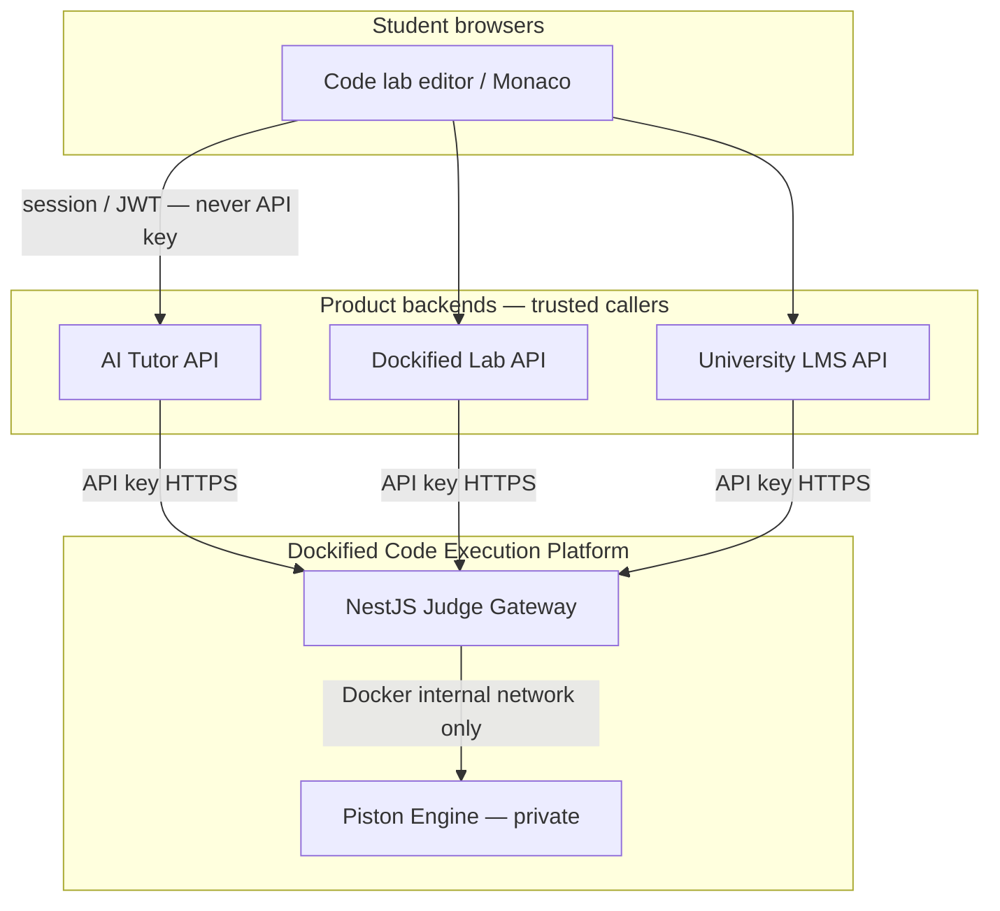
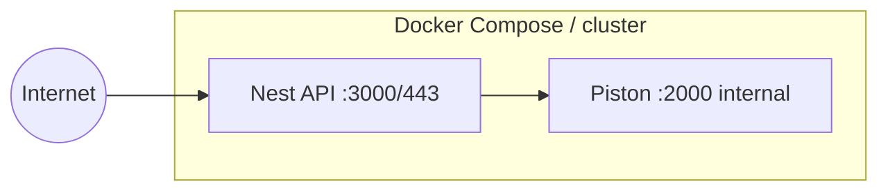
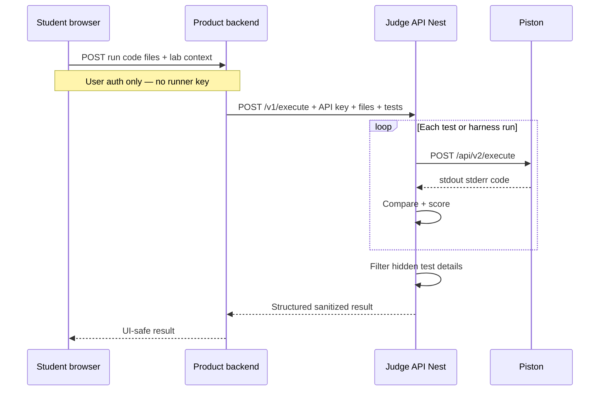

# Dockified Code Execution Platform — Architecture

**Status:** Draft (design approved for documentation)  
**Date:** 2026-07-19  
**Owner:** Dockified / Yeakkhai

## Purpose

Shared, production code-execution and judging service used by multiple products:

- AI Tutor (online code lab during tutoring and exercises)
- Dockified Lab / experiment products
- University LMS integrations

This service sits **in front of Piston**. Product backends never expose Piston to browsers or partners.

## System context

## Trust boundaries

| Actor | May call | Credentials |
|-------|----------|-------------|
| Student browser | Product backend only | User session / JWT |
| Product backend (tutor, lab, LMS) | Code execution API | `Authorization: Bearer <api_key>` |
| Code execution API | Piston | Private URL (no public auth) |
| Internet | **Must not** reach Piston | — |

## Container topology

| Service | Public? | Role |
|---------|---------|------|
| Nest judge/gateway | Yes (HTTPS) | Auth, limits, judge, sanitize |
| Piston | **No** | Sandbox run only |

## Request path (student hits Run)

## Why split (not inside one product)

| Decision | Rationale |
|----------|-----------|
| Separate judge API from AI Tutor | Reuse for Lab + university LMS |
| Nest in front of Piston | Piston has no product auth, grading, or multi-tenant keys |
| Piston private | Public Piston = open CPU abuse |
| API keys per client | Meter, revoke, isolate tutor vs LMS |

## Related docs

- [Full design spec](../superpowers/specs/2026-07-19-piston-code-execution-design.md)
- [Dockified Code Lab requirements](../requirements/code-lab-requirements.md) (summary alignment)
