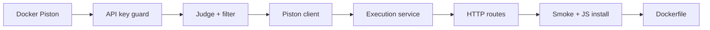

# Dockified Code Execution Platform — Clear Plan

**Date:** 2026-07-19  
**Status:** Approved for implementation  
**Product role:** Shared production service (AI Tutor, Dockified Lab, University LMS)  
**Repo:** NestJS judge/gateway + private Piston (Docker)

Related docs:

- Design: [../specs/2026-07-19-piston-code-execution-design.md](../specs/2026-07-19-piston-code-execution-design.md)
- Ship tasks: [./2026-07-19-piston-code-execution-ship.md](./2026-07-19-piston-code-execution-ship.md)
- Fast checklist: [../../runbooks/SHIP-FAST.md](../../runbooks/SHIP-FAST.md)
- Architecture diagrams: [../../architecture/code-execution-platform.md](../../architecture/code-execution-platform.md)

---

## 1. What we are building

A **shared code-execution and judging API** so product backends can:

1. Run student code safely (sandbox)  
2. Grade against **public** and **hidden** tests (HackerRank-style)  
3. Return structured results for the online code lab  

**Not building in this service:** Monaco UI, student login, full LMS, curriculum CMS.

---

## 2. Architecture (locked)

```text
┌─────────────┐  ┌──────────────┐  ┌─────────────────┐
│ AI Tutor API│  │ Dockified Lab│  │ University LMS  │
└──────┬──────┘  └──────┬───────┘  └────────┬────────┘
       │                │  API key (HTTPS)  │
       └────────────────┼───────────────────┘
                        ▼
              ┌─────────────────────┐
              │ Nest Judge Gateway  │  ← THIS service (public API)
              │ auth · limits ·     │
              │ judge · sanitize    │
              └──────────┬──────────┘
                         │ private Docker / VPC only
                         ▼
              ┌─────────────────────┐
              │ Piston (engine)     │  ← NOT public
              │ JS runtime (v1)     │
              └─────────────────────┘
```

```text
Student browser
      │  user session / JWT
      ▼
Product backend (Tutor / Lab / LMS)
      │  Authorization: Bearer <API_KEY>
      ▼
Nest  POST /v1/execute
      │
      ▼
Piston  POST /api/v2/execute   (internal)
```

| Layer | Tech | Public? |
|-------|------|---------|
| Judge API | NestJS + TypeScript | Yes (HTTPS + API key) |
| Sandbox | Piston via Docker | **No** |
| Language v1 | JavaScript only | — |

**Judge0 is not used.** “Judge0-like” only means API-key code-execution pattern.

---

## 3. Endpoints (v1)

| # | Method | Path | Auth | Role |
|---|--------|------|------|------|
| 1 | `POST` | `/v1/execute` | API key | Run and/or judge (main) |
| 2 | `GET` | `/v1/runtimes` | API key | List installed languages |
| 3 | `GET` | `/health` | None | Ops liveness |

**Business surface = 1 endpoint** (`/v1/execute`).  
Piston’s own routes are **internal only** (called by Nest, never by students).

### `POST /v1/execute` modes

| Mode | When | Behavior |
|------|------|----------|
| `run` | Console / try code | One Piston run → stdout/stderr |
| `judge` | Exercises / algorithms | For each test → run → compare → filter by visibility |

### Response rules (visibility)

| Test visibility | Student-facing fields |
|-----------------|------------------------|
| `public` | id, passed, status, stdin, expected, actual, stderr (capped) |
| `hidden` | id, passed, status only |

---

## 4. Auth & security (industry baseline)

| Control | v1 plan |
|---------|---------|
| Caller auth | `Authorization: Bearer <api_key>` |
| Who holds keys | Product **servers** only — never student browser |
| Student auth | On product backends, not this service |
| Piston | Private network; no public port in prod |
| Limits | Max files, file size, tests, run timeout (~3s) |
| Failures | WA/TLE/RE → HTTP 200 + structured status; bad key → 401; Piston down → 503 |

---

## 5. Queue: when and when not

| Phase | Queue? | Why |
|-------|--------|-----|
| **MVP / algorithms in lab** | **No** | Sync execute, short JS runs, simple |
| **Exams / big spikes / long jobs** | **Yes (later)** | Protect Piston; async “Judging…” UX |

**Algorithms need a judge, not necessarily a queue.**  
Queue is for **scale and long work**, not for “is it an algorithm problem.”

### Later (Phase 3) async shape

```text
POST /v1/submissions  →  { submissionId }  →  queue  →  workers  →  Piston
GET  /v1/submissions/:id  →  verdict when ready
```

Keep **Run = sync** (`/v1/execute`); **Submit = async** when needed.

---

## 6. Delivery phases

### Phase 1 — Ship (do this first)

```text
[1] Docker Compose: Nest + private Piston
[2] Install JavaScript on Piston (ppman)
[3] API key guard (env API_KEYS)
[4] Judge + public/hidden filter
[5] Piston HTTP client
[6] POST /v1/execute + GET /v1/runtimes + GET /health
[7] Unit tests + smoke script
[8] Dockerfile for Nest
[9] Client integration notes for Tutor/Lab/LMS
```

**Done when:** a product backend can call `/v1/execute` with a key, grade JS with public/hidden tests, and Piston is not exposed.

Detailed task steps: [2026-07-19-piston-code-execution-ship.md](./2026-07-19-piston-code-execution-ship.md)

### Phase 2 — Platform

- Hashed API keys + per-client quotas  
- More languages via `ppman`  
- Optional stored labs (`labId` + server-side harness)  
- Stronger rate limits (Redis if multi-instance)  

### Phase 3 — Scale

- Job queue + submission status API  
- Multiple Piston workers  
- Metrics/alerts on abuse and latency  

---

## 7. Implementation order (Phase 1)



| Step | Output |
|------|--------|
| 1 | `docker compose up piston` works |
| 2 | Invalid Bearer key rejected |
| 3 | Unit tests for compare + hidden strip |
| 4 | Mocked Piston client tests |
| 5 | Orchestration: run + judge modes |
| 6 | Live HTTP API |
| 7 | End-to-end smoke with real Piston |
| 8 | Full compose stack |

---

## 8. Tech stack (locked)

| Piece | Choice |
|-------|--------|
| API | NestJS 11 + TypeScript (strict) |
| Validation | class-validator + ValidationPipe |
| Engine | Piston (`ghcr.io/engineer-man/piston`) |
| Language v1 | JavaScript |
| Auth | Bearer API keys from env |
| Tests | Jest |
| Deploy local | Docker Compose |

---

## 9. Module layout (Nest)

```text
src/
  auth/           ApiKeyGuard
  config/         env helpers
  piston/         PistonClient
  execution/      DTO, Judge, Filter, ExecutionService, Controller
  health/         GET /health
  main.ts
  app.module.ts
```

---

## 10. Client contract (product backends)

```http
POST /v1/execute
Authorization: Bearer <API_KEY>
Content-Type: application/json
```

```json
{
  "language": "javascript",
  "files": [{ "name": "main.js", "content": "console.log(1+2)" }],
  "tests": [
    { "id": "sample", "expectedStdout": "3", "visibility": "public" },
    { "id": "hidden1", "expectedStdout": "3", "visibility": "hidden" }
  ],
  "context": {
    "enrollmentId": "…",
    "lessonId": "…",
    "labType": "exercise"
  }
}
```

Supports lab types via same payload:

| Lab type | How |
|----------|-----|
| Fill-in-gap | Assembled file(s) + tests |
| Exercise / multi-file | `files[]` tree + tests |
| Full code lab | Same multi-file + context |

---

## 11. Explicit non-goals (Phase 1)

- Public Piston  
- API keys in student browser  
- Student JWT on this service  
- Queue / Redis  
- Lab CRUD DB  
- All Piston languages  
- Judge0 or other vendor runner  

---

## 12. Definition of done (Phase 1)

- [ ] Piston runs in Docker; JS installed  
- [ ] Nest: `GET /health` → ok  
- [ ] Nest: `POST /v1/execute` with key → judge result  
- [ ] Hidden tests omit I/O in JSON  
- [ ] No key → 401  
- [ ] Unit tests green for guard, judge, filter, execution  
- [ ] Smoke script passes  
- [ ] Docs point clients at API key + execute only  

---

## 13. Next action

Implement **Phase 1** using the ship plan task checklist:

→ [2026-07-19-piston-code-execution-ship.md](./2026-07-19-piston-code-execution-ship.md)

Execution options: subagent-per-task or inline session implementation.
